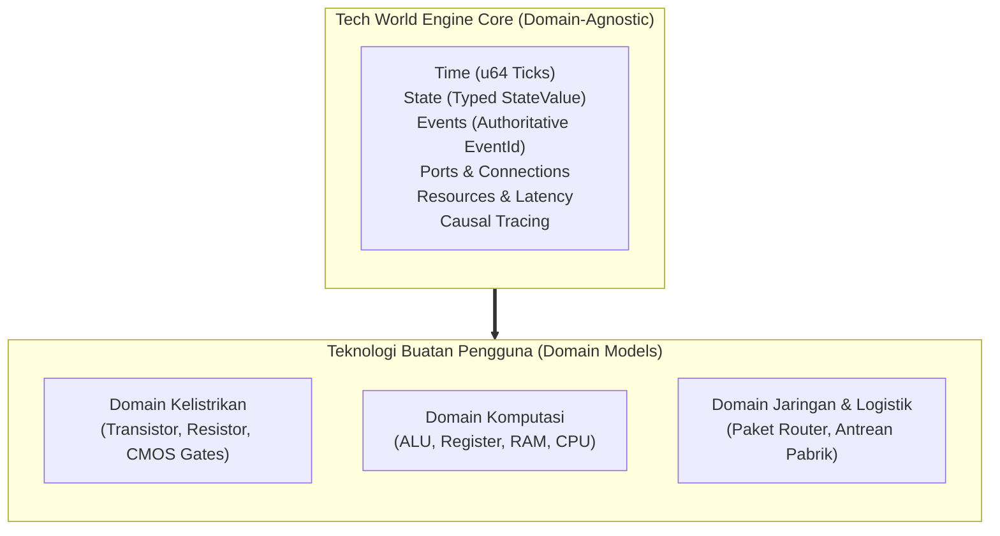

# Bab 01: Visi, Filosofi, & Prinsip Inti

> *"The engine knows nothing about CPUs, RAM, traffic lights, or transistors.  
> It only knows Time, State, Events, Components, Connections, and Resources."*

Dokumen ini menjelaskan **fondasi filosofis dan prinsip desain inti** yang mendasari pembuatan **Tech World Engine**. Memahami filosofi ini sangat penting sebelum Anda menulis baris kode pertama atau menambahkan fitur baru.

---

## 1. Visi Utama: Fondasi Konstruksi untuk Pengguna

Fokus utama dari proyek ini **bukanlah** menjadi emulator komputer digital statis atau simulator rangkaian listrik tertutup.

Fokus sesungguhnya adalah:
> **Membangun fondasi simulasi diskrit generik (*domain-agnostic discrete-event simulation platform*) yang memberdayakan pengguna untuk memodelkan, merangkai, menguji, dan memvalidasi komponen domain mereka sendiri secara mandiri, deterministik, dan dapat dijelaskan (*explainable*).**

Segala bentuk teknologi—mulai dari sakelar sederhana, gerbang logika CMOS, ALU, antrean jaringan, pabrik logistik, hingga prosesor lengkap—**tidak pernah di-hardcode** ke dalam engine core. Semua objek tersebut adalah **komposisi buatan pengguna (*user-defined compositions*)**.

---

## 2. Empat Prinsip Desain Mutlak (*The Four Invariants*)

Untuk menjaga agar engine tetap bersih, cepat, dan terukur sepanjang masa, ada empat prinsip invarian yang tidak boleh dilanggar:

### Invarian 1: Pemisahan Tegas Domain (*Strict Decoupling*)
* `tw-core` tidak boleh memiliki sebaris pun kode yang mengetahui istilah spesifik domain seperti `Voltage`, `Resistance`, `CPU`, `Byte`, atau `Cart`.
* Konsep domain hanya boleh hidup di folder model (seperti `models/electrical`) atau di dalam kode yang dibuat oleh pengguna.
* Arah dependensi adalah **satu arah ke bawah**:
  $$\text{Frontend (CLI/Godot)} \longrightarrow \text{tw-scene} \longrightarrow \text{tw-sim} \longrightarrow \text{tw-core}$$

### Invarian 2: Determinisme & Integritas Kausalitas
* Simulasi dengan konfigurasi dan input yang identik **wajib menghasilkan urutan event dan state akhir yang identik 100% di setiap mesin dan setiap run**.
* **Engine bersifat otoritatif atas identitas event (`EventId`)**: Komponen pengguna tidak boleh mengarang ID event sendiri yang dapat memicu tabrakan pada tick yang sama.
* Waktu tidak boleh bergerak mundur ($t_{\text{next}} \ge t_{\text{current}}$).

### Invarian 3: Waktu Diskrit Fixed-Point (`u64 Ticks`)
* Waktu simulasi (`SimulationTime`) direpresentasikan sebagai bilangan bulat tidak bertanda (`u64 ticks`), **bukan `f64`**.
* *Mengapa bukan `f64`?* Karena floating-point membawa ketidakpastian pembulatan IEEE-754 antar-CPU, non-asosiatif ($a + (b + c) \ne (a + b) + c$), dan rawan bug akumulasi presisi pada simulasi berdurasi panjang.
* Konversi waktu kontinu (detik/nanodetik ke ticks) dilakukan secara eksplisit di batas sistem (misal lewat `TimeBase` atau konversi `ticks_per_second` di `tw-scene`).

### Invarian 4: Kausalitas yang Dapat Dijelaskan (*Explainability*)
* Setiap perubahan state harus memiliki penyebab yang dapat dilacak balik (*traceable causality*).
* Engine menyediakan [`CausalGraph`](file:///home/rkcode/Projects/tech-world-engine/crates/tw-core/src/tracing/causal_graph.rs) yang merekam hubungan sebab-akibat (*cause $\to$ effect*).
* Frontend (baik CLI maupun visualizer Godot) dapat menanyakan: *"Mengapa lampu ini menyala?"* atau *"Mengapa paket data ini terlambat?"*, dan engine mampu merekonstruksi rantai event pemicunya secara topologis tanpa rekursi sirkular.

---

## 3. Kompleksitas Lahir dari Komposisi (*Emergent Complexity*)

Salah satu jebakan terbesar dalam membangun software simulasi adalah membuat class khusus untuk setiap benda di dunia nyata (misalnya: `class Computer`, `class RAM`, `class Disk`).

Tech World Engine menolak pendekatan tersebut. Di engine ini:
* **Tidak ada komponen ajaib (*no magic components*)**: Sebuah memori 1-bit bukanlah variabel `bool memory`, melainkan sepasang gerbang NOR yang dirangkai secara silang (*cross-coupled NOR latch*) atau sebuah master-slave flip-flop.
* **Komposisi Hierarkis**:
  $$\text{Primitive Component} \longrightarrow \text{Composite} \longrightarrow \text{Subassembly} \longrightarrow \text{Full System}$$
* Emergen: Perilaku latensi antrean, perebutan kapasitas sumber daya, dan delay propagasi sinyal tidak diprogram manual dengan `if/else`, melainkan **muncul secara alami (*emergent*)** dari interaksi antar-primitive di dalam kernel.

---

## 4. Peran Abstraksi Multi-Fidelity

Jika semua hal disimulasikan hingga ke level persamaan diferensial fisik (misalnya ribuan transistor yang dihitung dengan matriks MNA), simulasi skala besar (misal 1 juta komponen) akan berjalan sangat lambat.

Untuk mengatasi trade-off ini, Tech World Engine memperkenalkan konsep **Multi-Fidelity**:
1. **Fidelity Fisik (Transistor/MNA)**: Mengintegrasikan persamaan non-linear fisika untuk mengukur karakteristik asli (propagation delay $t_{\text{pd}}$, rise/fall time, konsumsi energi).
2. **Karakterisasi Otomatis**: Hasil simulasi fisik diukur secara otomatis oleh mesin.
3. **Fidelity Diskrit Terabstraksi (*Derived Component*)**: Karakteristik terukur tersebut dimasukkan ke dalam komponen diskrit event-driven murni (`tw_core::Component`).
4. **Hasil**: Komponen tingkat tinggi berjalan ribuan kali lebih cepat, tetapi memiliki perilaku waktu dan energi yang berakar langsung pada hukum fisika nyata.

---

## 5. Ringkasan Model Mental

Bagi seorang pembuat model, cara berpikir di dalam Tech World Engine adalah:
1. **Dunia adalah sekumpulan Komponen** yang memiliki **Port** (Input/Output).
2. **Komponen berkomunikasi melalui Event/Sinyal** yang dialirkan lewat **Koneksi**.
3. **Komponen tidak memiliki loop/thread sendiri**; komponen hanya bereaksi saat event tiba di method `handle_event`.
4. **Resource mengatur batas fisik** (kapasitas mesin, bandwidth, kuota antrean) dan menghasilkan latensi alami.
5. **Dunia didefinisikan secara deklaratif**, bukan di-hardcode ke dalam engine.
