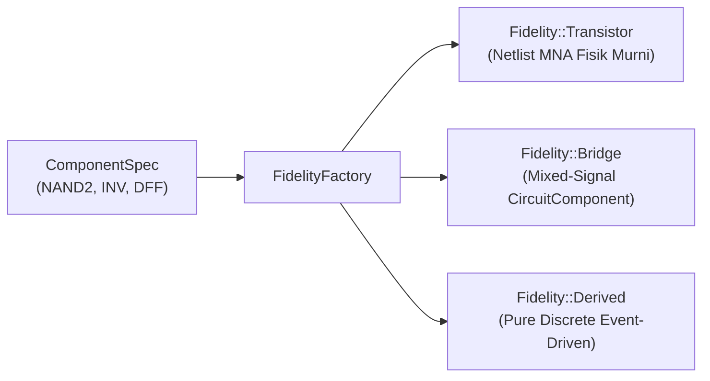

# Bab 05: Fisika Sirkuit & Multi-Fidelity Abstraction

Salah satu pencapaian terbesar dalam Tech World Engine adalah kemampuannya menghubungkan **hukum fisika rangkaian listrik kontinu** dengan **kecepatan simulasi diskrit event-driven** melalui mekanisme **Multi-Fidelity Abstraction**.

Domain kelistrikan ini diimplementasikan secara terisolasi di package [`tw-electrical`](file:///home/rkcode/Projects/tech-world-engine/models/electrical/) tanpa mengotori `tw-core`.

---

## 1. Fondasi Fisika: MNA (*Modified Nodal Analysis*)

Rangkaian analog dimodelkan sebagai graf berarah dengan node dan cabang (*branches*). Solver MNA (standar industri yang dipakai SPICE) menyusun persamaan Kirchhoff (KCL dan KVL) ke dalam bentuk persamaan aljabar matriks:

$$
\begin{bmatrix}
G & B \\
C & D
\end{bmatrix}
\begin{bmatrix}
v \\
j
\end{bmatrix}
=
\begin{bmatrix}
i \\
e
\end{bmatrix}
$$

* $v$: Vektor potensial tegangan pada setiap node bebas (node ground $0\text{ V}$ tidak dihitung untuk mencegah matriks singular).
* $j$: Vektor arus cabang pada sumber tegangan independen.
* Solver `tw-num` menyelesaikan sistem ini menggunakan **Sparse LU dengan Markowitz Pivoting** untuk stabilitas numerik.

### A. Model Komponen Fisik Dasar
1. **Resistor ($R$)**: Konduktansi $G = 1/R$ di-stamp ke submatriks konduktansi.
2. **Kapasitor ($C$)**: Menggunakan diskritisasi implisit **Backward Euler** dengan langkah waktu $\Delta t$:
   $$G_{eq} = \frac{C}{\Delta t}, \quad I_{eq} = G_{eq} \cdot \left(V_+(t_n) - V_-(t_n)\right)$$
   Persamaan diferensial kapasitor diubah menjadi resistor ekuivalen dan sumber arus riwayat pada setiap time step!
3. **Dioda Shockley**: $I_D = I_S \left(e^{V_D / \eta V_T} - 1\right)$ dengan ekstrapolasi linear untuk mencegah overflow floating-point.
4. **MOSFET (NMOS & PMOS Level 1)**: Model Shichman-Hodges dengan 3 daerah kerja (Cutoff, Triode/Linear, Saturation) dan modulasi panjang kanal $\lambda$.

---

## 2. Pembangunan Gerbang Logika & Memori Fisik

Engine berhasil membuktikan **Milestone Besar #1**:
> **Gerbang logika dan memori bistabil tercipta murni dari dinamika medan listrik transistor fisik tanpa percabangan logika software (`if/else`).**

```text
               VDD (5V)
                  │
            ┌─────┴─────┐
            │           │
         PMOS (A)    PMOS (B)     <- Pull-Up Network (Paralel)
            │           │
            └─────┬─────┘
                  ├─── OUT
            ┌─────┴─────┐
         NMOS (A)       │         <- Pull-Down Network (Seri)
            │           │
         NMOS (B)       │
            │           │
            └─────┬─────┘
                  │
                 GND (0V)
```

1. **CMOS NAND2**: 2 PMOS paralel di atas, 2 NMOS seri di bawah. Menghasilkan tabel kebenaran NAND murni dari konduktansi semikonduktor.
2. **CMOS NOR2 & Compound AND/XOR**: Komposisi modular bertingkat (*nested subcircuits*).
3. **Memori Sekuensial Fisik (Master-Slave D Flip-Flop)**:
   - Dua tingkat latch gated NAND yang dipicu oleh clock komplementer.
   - Sinyal ditangkap hanya pada *rising edge* clock dan disimpan oleh muatan kapasitor internal tanpa kode boolean buatan.

---

## 3. Alur Abstraksi Multi-Fidelity (Milestone Besar #2)

Menjalankan jutaan transistor secara analog dengan time-step picosecond sangat mahal secara komputasi. Oleh karena itu, engine menerapkan alur abstraksi 4 tahap:

```text
Detailed Model (Transistor Physical Circuit)
      │
      ▼ (Simulasi Transient & DC Operating Point)
Observation & Measurement (Automated Characterizer)
      │ Mengukur: t_pHL, t_pLH, t_r, t_f, Energi (pJ)
      ▼
Extract Behavior (Derived Table & Timing Rules)
      │
      ▼
Abstract Discrete Model (DerivedGate & DerivedDff di tw-core)
      │
      ▼
Validation (Paritas Fungsional & Timing vs Fisik)
```

### A. Pengukuran Karakteristik Otomatis ([`Characterizer`](file:///home/rkcode/Projects/tech-world-engine/models/electrical/src/characterization.rs))
Mesin otomatis mensimulasikan sirkuit fisik transistor dan mengukur:
* **Tegangan Ambang Logika**: Ambang switching diukur dari $V_{in}$ saat $V_{out} = V_{dd}/2$.
* **Propagation Delay ($t_{\text{pHL}}, t_{\text{pLH}}$)**: Waktu dari transisi input 50% hingga transisi output 50%.
* **Rise/Fall Time ($t_r, t_f$)**: Waktu transisi antara level 10% dan 90%.
* **Konsumsi Energi Dinamis**: Integrasi numerik aturan trapesium daya supply:
  $$E = \int V_{\text{supply}} \cdot (-I_{\text{supply}}) \, dt$$

Hasil pengukuran default (Vdd 5V, $C_L$ 10pF, $\Delta t$ 0.05ns):
| Komponen Fisik | $t_{\text{pHL}}$ | $t_{\text{pLH}}$ | Energi per Siklus |
| --- | :---: | :---: | :---: |
| **Inverter** | $\approx 2.75\text{ ns}$ | $\approx 2.75\text{ ns}$ | $\approx 249.9\text{ pJ}$ |
| **NAND2** | $\approx 2.85\text{ ns}$ | $\approx 2.75\text{ ns}$ | $\approx 249.9\text{ pJ}$ |
| **D Flip-Flop** | $\approx 3.51\text{ ns}$ | $\approx 3.03\text{ ns}$ | $\approx 311.2\text{ pJ}$ |

### B. Komponen Diskrit Turunan ([`DerivedGate`](file:///home/rkcode/Projects/tech-world-engine/models/electrical/src/derived.rs))
Karakteristik di atas dimasukkan ke dalam `DerivedGate`:
* Berjalan di engine diskrit `tw-core` (event-driven).
* Menunda pengiriman sinyal output sebesar $t_{\text{pd}}$ yang dikuantisasi ke `SimulationTime` ticks.
* Menggunakan *inertial delay*: jika input berubah kembali sebelum delay selesai, event yang basi otomatis dibatalkan.
* Menyimpan metrik energi fisik terukur di variabel `State`.

---

## 4. Tiga Tingkat Representasi (`FidelityFactory`)

Pengguna dapat memilih fidelity komponen pada saat konstruksi menggunakan [`FidelityFactory`](file:///home/rkcode/Projects/tech-world-engine/models/electrical/src/fidelity.rs):



1. **`Transistor`**: Netlist fisik mentah. Menghasilkan bentuk gelombang tegangan analog kontinu.
2. **`Bridge` (`CircuitComponent`)**: Jembatan mixed-signal. Komponen diskrit `tw-core` yang membungkus solver sirkuit analog dan menerjemahkan `PortSignal` diskrit ke sumber tegangan fisik.
3. **`Derived` (`DerivedGate` / `DerivedDff`)**: Komponen diskrit murni dengan delay dan energi terukur. Sangat cepat dan terukur hingga jutaan komponen.

---

## 5. Bukti Skalabilitas & Benchmark Komputasi (Milestone Besar #3)

Benchmark empiris (`models/electrical/benches/fidelity_scaling.rs`) membandingkan biaya komputasi satu switching event gerbang NAND pada ketiga fidelity:

| Tingkat Fidelity | Waktu Eksekusi per Switching Event | Rasio Performa |
| --- | :---: | :---: |
| **Transistor Fisik MNA** | $\approx 13.400\,\mu\text{s}$ (13.4 ms) | $1\times$ (Baseline analog) |
| **Mixed-Signal Bridge** | $\approx 13.300\,\mu\text{s}$ (13.3 ms) | $\approx 1\times$ |
| **Derived Discrete Gate** | $\approx 4\,\mu\text{s}$ | **$\approx 3.300\times$ lebih cepat!** |

### Implikasi Skalabilitas:
* **Pada 100.000 Gerbang Derived**: Seluruh 100.000 gerbang NAND yang serentak berganti state selesai dieksekusi dalam **$\approx 1.0$ detik**.
* **Pada 1.000.000 Gerbang (Stress Test)**: Engine tetap stabil dengan alokasi memori linear tanpa kebocoran state.

> **Kesimpulan:** Abstraksi multi-fidelity membuktikan bahwa kita tidak perlu mengorbankan kebenaran fisika demi performa. Komponen diskrit tingkat tinggi dapat dipercaya karena karakteristik perilakunya diukur langsung dari model transistor dasar.
