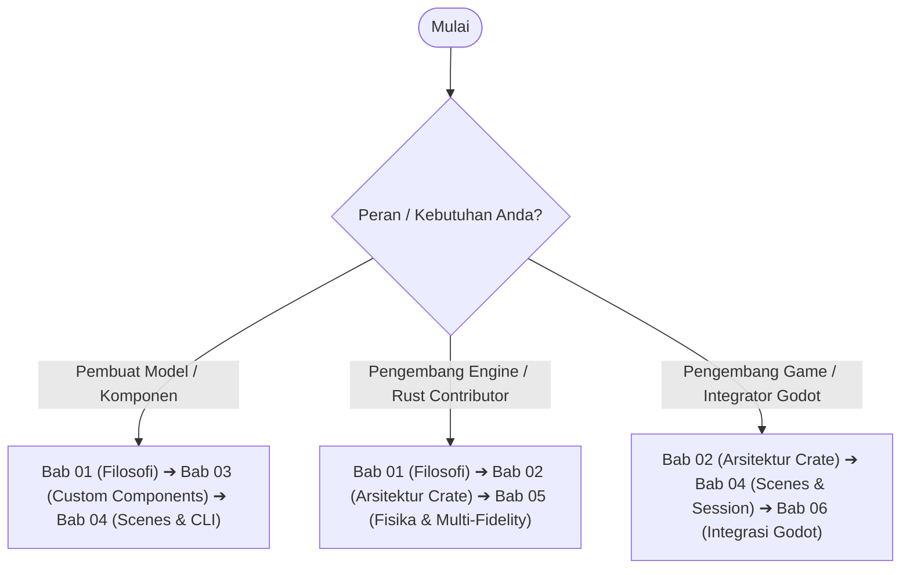

# Buku Panduan Resmi Tech World Engine (Manual & Architecture Guide)

Selamat datang di buku panduan resmi **Tech World Engine**. Dokumentasi ini dirancang untuk memberikan pemahaman menyeluruh dan terstruktur mengenai arsitektur, filosofi, cara pembuatan komponen mandiri, format dunia deklaratif, serta integrasi visual proyek ini.

---

## 🗺️ Peta Dokumen

Manual ini dibagi menjadi 6 bab terstruktur:

| Bab | Judul Dokumen | Fokus Utama |
| :---: | :--- | :--- |
| **01** | [**Visi, Filosofi, & Prinsip Inti**](01_vision_and_philosophy.md) | Visi domain-agnostik, filosofi *user-authored components*, pemisahan tegas (*strict decoupling*), dan determinisme DES. |
| **02** | [**Arsitektur Sistem & Crate Reference**](02_architecture_and_crates.md) | Peta crate (`tw-core`, `tw-sim`, `tw-scene`, `tw-cli`, `tw-num`, `tw-electrical`), arah dependensi, dan invarian teknis. |
| **03** | [**Panduan Pembuatan Komponen Mandiri**](03_custom_component_guide.md) | Tutorial praktis membuat komponen sendiri: Port, StateValue, lifecycle (`on_mount`, `on_unmount`, `restore_state`), Resource, dan pengujian. |
| **04** | [**Format Deklaratif `.twscene` & Panduan CLI**](04_declarative_scenes_and_cli.md) | Skema JSON `.twscene`, Component Registry, façade `Session`, state diffing, serta perintah CLI (`run`, `inspect`, `trace`). |
| **05** | [**Fisika Sirkuit & Multi-Fidelity Abstraction**](05_physics_and_multi_fidelity.md) | Solver MNA, transistor CMOS, jembatan mixed-signal, karakterisasi delay/energi, dan benchmark performa (1 ke 1.000.000 komponen). |
| **06** | [**Panduan Integrasi Godot & Client Eksternal**](06_godot_and_frontend_guide.md) | Arsitektur GDExtension tipis (*thin adapter*), sinkronisasi waktu Godot `_process(delta)` ke ticks, dan rendering reaktif. |

---

## 🎯 Alur Membaca yang Disarankan (*Reading Paths*)

Pilihlah alur membaca sesuai dengan kebutuhan Anda:



### 1. Jalur Pembuat Komponen / Modeler
Bila Anda ingin memodelkan sistem (logistik, jaringan data, rangkaian digital, sistem IoT):
1. Baca [**Bab 01**](01_vision_and_philosophy.md) untuk memahami model mental waktu diskrit dan event-driven.
2. Pelajari [**Bab 03**](03_custom_component_guide.md) untuk melihat contoh implementasi trait `Component` lengkap dengan penanganan port dan resource.
3. Gunakan [**Bab 04**](04_declarative_scenes_and_cli.md) untuk merangkai komponen Anda ke dalam file `.twscene` dan mengujinya lewat CLI.

### 2. Jalur Pengembang Core Engine
Bila Anda ingin berkontribusi pada kernel simulasi, solver numerik, atau domain fisik:
1. Pahami batas-batas domain dan invarian dependency di [**Bab 01**](01_vision_and_philosophy.md) dan [**Bab 02**](02_architecture_and_crates.md).
2. Dalami implementasi solver MNA, transistor Shichman-Hodges, dan abstraksi multi-fidelity di [**Bab 05**](05_physics_and_multi_fidelity.md).

### 3. Jalur Integrator Godot / Frontend
Bila Anda ingin menampilkan simulasi secara visual atau membuat kontrol interaktif di Godot 4:
1. Pahami lapisan antarmuka `tw-scene` di [**Bab 02**](02_architecture_and_crates.md) dan [**Bab 04**](04_declarative_scenes_and_cli.md).
2. Terapkan arsitektur GDExtension tipis sesuai cetak biru di [**Bab 06**](06_godot_and_frontend_guide.md).

---

## ⚡ Quick Test & Verifikasi Lingkungan

Pastikan seluruh workspace terkompilasi dan pengujian otomatis lulus sebelum memulai eksperimen:

```bash
cargo build --workspace
cargo test --workspace

# Jalankan skenario deklaratif bawaan
cargo run -p tw-cli -- run scenes/counter.twscene --ticks 50
cargo run -p tw-cli -- run scenes/logic_gates.twscene
cargo run -p tw-cli -- trace scenes/logic_gates.twscene --component 2
```
